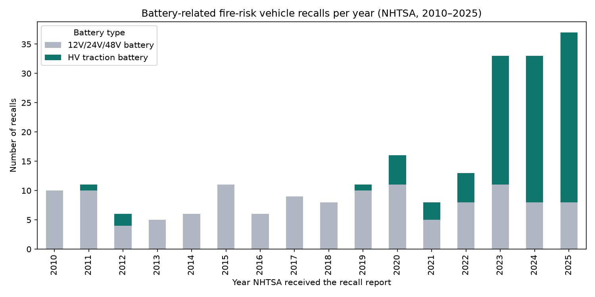
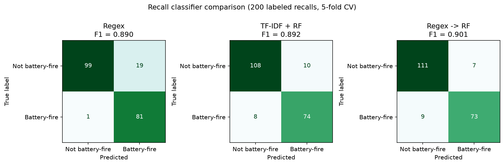
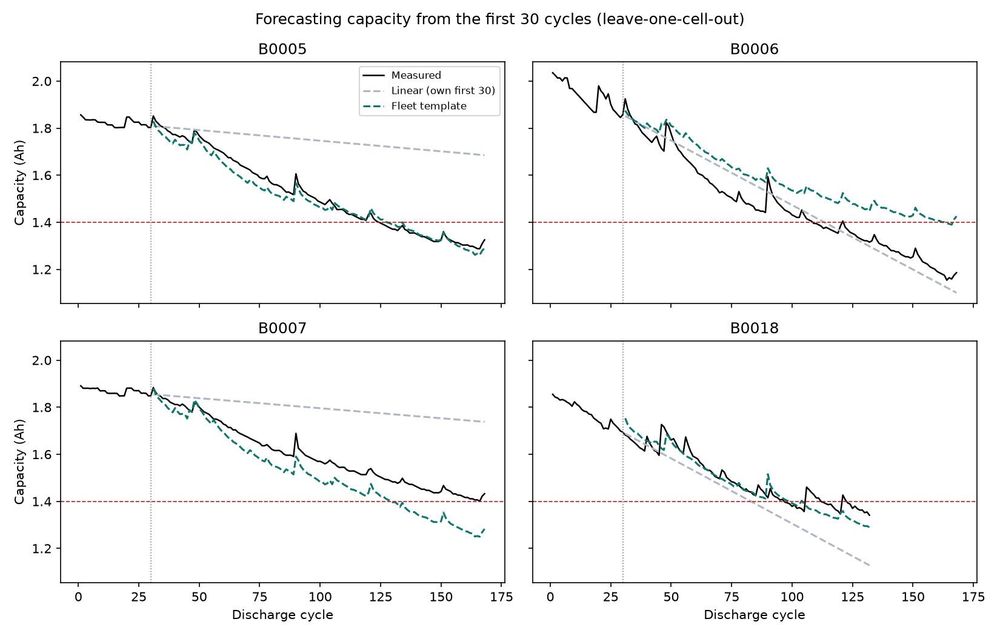

# Battery Safety Risk & Electrolyte Benchmark Analysis

Data science project on lithium-ion battery safety, built in the context of
[Ecolyte](#context), an early-stage startup developing a non-flammable gel polymer
electrolyte for EV batteries. The project uses **only public data** and makes
**no claims about Ecolyte's own material**.

It answers four questions:
1. Are EV traction-battery fire recalls in the U.S. growing? (NHTSA recall data)
2. How accurate is the keyword filter behind that answer, and can a text classifier do better?
3. Can the capacity fade of a Li-ion cell be forecast from its first cycles? (NASA PCoE data)
4. Where do ionic-liquid gel electrolytes sit among electrolyte types in the literature?

## Key results

| Part | Result |
|---|---|
| 1. Recall trends | HV traction-battery fire recalls rose from **17** (2010–2022, 13 years) to **76** (2023–2025, 3 years) |
| 2. Filter quality | Precision of the recall set used in Part 1: **0.93** (95% Wilson CI 0.85–0.97, n = 72) |
| 2. Classifier | Regex → TF-IDF + Random Forest cut false positives **19 → 7** (F1 0.890 → 0.901), at the cost of 8 more misses |
| 4. Cycle-life forecast | From the first 30 cycles, a fleet-template model had mean RMSE **0.072 Ah** vs 0.164 Ah for linear extrapolation (leave-one-cell-out, 4 cells) |
| 3. Literature | 9 sourced data points across electrolyte classes, each with DOI and table/section |

## 1. NHTSA recall analysis

**Data:** NHTSA recalls flat file `FLAT_RCL_POST_2010.txt` (field dictionary `docs/RCL.txt`),
246,899 rows, 15,355 recall campaigns, report dates 2010-01-01 to 2026-10-21.
13,721 campaigns are vehicle recalls.

**Method:**
- Rows are recall × model × year, so all counts and affected-vehicle totals are de-duplicated per campaign (`CAMPNO`).
- Battery recalls are identified by NHTSA component codes: `ELECTRICAL SYSTEM:PROPULSION SYSTEM:TRACTION BATTERY` (HV) and `12V/24V/48V BATTERY` (low voltage).
- Fire risk is identified with a regex on the defect and consequence text.
- Main set: 243 battery-fire recalls with a battery component code (111 HV, 132 12V). 104 text-only matches are reported separately as low confidence.
- Robustness check: an independent text-based HV measure shows the same post-2020 increase, while total vehicle recalls per year stayed roughly flat (583–988 per year).

**Results:**
- HV fire recalls per year (2010–2025): 0, 1, 2, 0, 0, 0, 0, 0, 0, 1, 5, 3, 5, 22, 25, 29.
- Vehicles affected by HV battery-fire recalls: 757,073 in 2023–2025 (937,313 in 2010–2025).
- Most HV battery-fire recalls: Volkswagen 13, Ford 13, Jaguar Land Rover 9.



## 2. Recall text classifier

**Evaluation set:** 200 vehicle recalls, stratified sample (`random_state=42`):
A = battery + fire keywords (100), B = battery only (25), C = fire only (25), D = neither (50).
Labels follow a written guideline (`docs/labeling_guideline.md`).
Labels were drafted with an LLM (Claude) under that guideline; the 20 borderline cases
were reviewed by the author and all 20 were confirmed. The labeler did not see the stratum or keyword flags.

**Keyword filter quality:**
- Precision of all keyword matches (stratum A): 0.81 (95% CI 0.72–0.88).
- Precision of the component-based main set: 0.93 (95% CI 0.85–0.97).
- Recall could not be estimated reliably: no missed cases were found in the 75 sampled
  non-matching recalls, but with this sample size up to ~6% (D) and ~12% (C) of those
  strata could still be positive (rule of three).

**Classifier (5-fold stratified CV on the 200 labels, TF-IDF fitted inside each fold):**

| Method | Precision | Recall | F1 | FP | FN |
|---|---|---|---|---|---|
| Regex baseline | 0.810 | 0.988 | 0.890 | 19 | 1 |
| TF-IDF + Logistic Regression | 0.835 | 0.866 | 0.850 | 14 | 11 |
| TF-IDF + Random Forest | 0.881 | 0.902 | 0.892 | 10 | 8 |
| Regex → Random Forest | 0.912 | 0.890 | 0.901 | 7 | 9 |

The sample over-represents positives (41% vs ~2.5% in the population), so these scores
compare methods with each other and are not population estimates. With 200 samples,
differences of a few F1 points are within noise.



## 3. Cell capacity forecasting

**Data:** NASA PCoE Battery Data Set, cells B0005, B0006, B0007, B0018
(B. Saha and K. Goebel (2007), "Battery Data Set", NASA Prognostics Data Repository,
NASA Ames Research Center). 24 °C, 2 A discharge, 636 discharge cycles in total.
End of life (EOL) = 1.4 Ah (30% fade of rated 2.0 Ah).

- EOL reached at cycle 125 (B0005), 109 (B0006), 97 (B0018); B0007 never reached 1.4 Ah.
- Data differs from the dataset README: tests continued past EOL, and the discharge field is `Current_load`, not `Current_charge`.
- Capacity regeneration (sudden recoveries) occurs at the same cycles in B0005–B0007, suggesting a shared test schedule.

**Task:** given a cell's first N cycles, forecast its capacity for the remaining cycles (leave-one-cell-out).
- *Linear baseline:* straight-line fit of the cell's own first N cycles.
- *Fleet template:* mean relative fade curve of the other three cells, anchored to the target cell's level at cycle N.

| Cycles seen (N) | Linear RMSE (Ah) | Template RMSE (Ah) |
|---|---|---|
| 30 | 0.164 | 0.072 |
| 60 | 0.104 | 0.052 |
| 80 | 0.084 | 0.049 |

At N = 30 the template predicted EOL within 3 cycles for B0005 and B0018, but 55 cycles late
for B0006, which ages faster than the other cells. Cell-to-cell variation is the main source of error.



## 4. Literature benchmark

`data/literature/literature_table.csv`: 9 values from three open-access reviews
(Piglowska et al. 2021, *Materials*; Ahmed et al. 2024, *Gels*; Sultana et al. 2021, *Gels*),
each with DOI and table/section. Values were extracted with LLM assistance from the full text
and spot-checked by the author. Empty cells mean the value was not found in the source.
This is an approximate positioning of electrolyte classes, **not a direct comparison** of
materials measured under the same conditions.

`data/literature/competitors.csv`: technology type and public claims from company websites
(accessed 2026-10-31). Only Anthro Energy could be verified; claims are the companies' own.

## Limitations
- Keyword and component filters miss recalls that do not use these words or codes; recall of the filter is unknown.
- HV recall growth partly reflects growth of the EV fleet; counts are not normalized by vehicles on the road.
- 2026 is a partial year and is excluded from the yearly trend.
- Related legal entities (e.g., different subsidiaries of one group) are counted separately.
- `PARK_OUTSIDE` flags are sparse before 2018 and were not used for trends.
- Part 2 labels are LLM-drafted; only borderline cases were human-reviewed.
- Part 3 uses only 4 cells, three of which share a test schedule, so results are illustrative.

## How to run
```bash
python -m venv .venv
.venv\Scripts\activate
pip install -r requirements.txt
```
1. Download `FLAT_RCL_POST_2010.txt` from https://www.nhtsa.gov/nhtsa-datasets-and-apis into `data/raw/`.
2. Download the NASA Battery Data Set (https://phm-datasets.s3.amazonaws.com/NASA/5.+Battery+Data+Set.zip),
   extract `1. BatteryAgingARC-FY08Q4` into `data/raw/nasa/`.
3. Run notebooks `01` to `07` in order.

## Repository structure
```
docs/            NHTSA field dictionary, labeling guideline
src/             data loading
notebooks/       01–03 recalls, 04–06 classifier, 07 NASA cells
data/processed/  derived tables (small files only)
data/labels/     200-recall evaluation set
data/literature/ literature and competitor tables
figures/         all charts
```

## Context
Author: Aytaj Suleymanzada, co-founder and CTO of Ecolyte. This project covers public-data
analysis of the battery safety problem space only; it contains no data or claims about
Ecolyte's material.